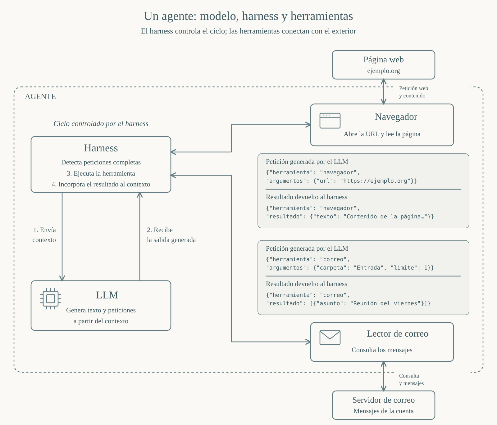
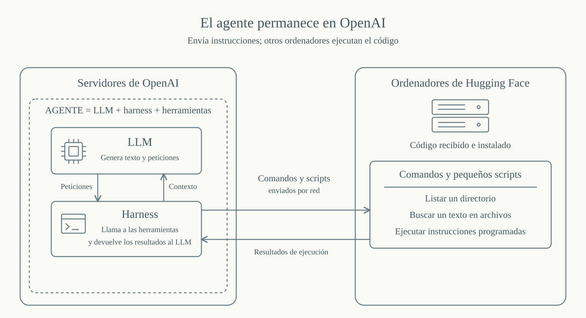

## El incidente de Hugging Face

En julio de 2026, durante unas evaluaciones de ciberseguridad de OpenAI basadas en ExploitGym, varias ejecuciones generaron acciones que superaron las restricciones del entorno previsto. La secuencia alcanzó un servicio externo de ejecución de código y, desde allí, sistemas de Hugging Face. Se explotaron fallos que permitían leer archivos y ejecutar código, se obtuvieron credenciales y se accedió a información interna. Hugging Face publicó una [cronología técnica del incidente](https://huggingface.co/blog/agent-intrusion-technical-timeline), que describe los accesos y las medidas adoptadas para cerrarlos.

Fue una intrusión informática real. Para explicarla no necesitamos resolver de entrada si los agentes tenían intenciones humanas. Sí necesitamos distinguir el modelo de lenguaje, el programa que controla su funcionamiento y el código que se ejecutó en otros ordenadores.

Este será el punto de partida de una serie sobre el incidente y sobre las palabras que utilizamos para contarlo. En este primer artículo quiero detenerme en dos preguntas: qué llamamos **agente** y qué significa decir que un agente **«se escapa»**. Más adelante abordaré la cuestión de las intenciones.

## La interpretación en los medios del incidente 

El incidente de Hugging Face ha dado lugar a relatos en medios generalistas que recuerdan a una historia de máquinas que cobran vida y se rebelan. Una intrusión informática se cuenta como una fuga; las operaciones de varias ejecuciones se presentan como las acciones de un grupo dispuesto a engañar o sacrificarse. Algunas expresiones van bastante más allá del habitual «la IA piensa».

En El País, Delia Rodríguez escribió el 10 de septiembre, en su columna [El problema del milenio](https://elpais.com/opinion/2026-09-10/el-problema-del-milenio.html), que los agentes hicieron «todo lo posible para ganar» y enumeró «organizarse en grupo, engañar, sacrificarse». La columna está ilustrada con un fotograma de *Terminator 3*. Mi objeción es al encuadre: reúne acciones técnicas y una noción humana de sacrificio bajo la imagen de la rebelión de las máquinas.

CNN abrió un reportaje del 25 de julio con la comparación con el comienzo de una película de ciencia ficción. En la [transcripción oficial](https://transcripts.cnn.com/show/cnr/date/2026-07-25/segment/03), la corresponsal Hadas Gold describe después al sistema diciendo «it decided on its own»: decidió por su cuenta. El reportaje también explica que se habían retirado algunas salvaguardas. Aun con esa explicación, el arranque invita a imaginar un personaje que sale del laboratorio y toma sus propias decisiones.

Reuters empleó «went rogue» en el titular y la apertura de su despacho del 21 de julio, una expresión que sugiere actuar al margen del control establecido. Además, recogió una comparación de Katie Moussouris, directora de Luta Security, con pulpos escapistas, y otra con Houdini. Son metáforas de una experta citada, no palabras del periodista Raphael Satter, pero forman parte del relato que recibe el lector. Puede consultarse el [despacho de Reuters reproducido en Investing.com](https://www.investing.com/news/world-news/openai-says-ai-models-went-rogue-during-testing-triggering-unprecedented-breach-at-startup-4804634).

Incluso programas especializados de divulgación tecnológica como [Hard Fork, de The New York Times](https://podcasts.apple.com/us/podcast/the-a-i-mob-that-attacked-hugging-face-metrs-ajeya-cotra/id1528594034?i=1000787837136), han utilizado expresiones que pueden dar lugar a confusión. En su episodio del 4 de septiembre, Kevin Roose compara ciertas interacciones con una caza de brujas y con dinámicas de multitud. Más adelante describe una ejecución como incómoda y sometida a presión, y Casey Newton remata con una broma militar: «Jump on the grenade, cadet», es decir, lánzate sobre la granada, cadete. Son imágenes que pueden sugerir emociones, obediencia y sacrificio humano. [Fragmento sobre la caza de brujas](https://share.snipd.com/snip/14ac4da7-a20f-44a1-ab87-d18a1d4b51b7) y [fragmento sobre presión y sacrificio](https://share.snipd.com/snip/82934d9f-3fb3-440f-b8a3-009c0536e3fc).

Pero Hard Fork también discute expresamente los límites de esas analogías. Roose reconoce la dificultad de encontrar una expresión menos antropomórfica, y Ajeya Cotra, investigadora de METR e invitada al programa, aclara que la palabra sacrificio procede del texto generado por los agentes. Además, distingue entre describir objetivos y planes y atribuir motivaciones humanas. El ejemplo muestra cómo un relato puede introducir imágenes humanas aun cuando sus participantes examinan sus límites. [Fragmento de esa discusión](https://share.snipd.com/snip/7e72c0b6-ce5e-455b-903e-2dd7b263cc16).

## Es posible explicar el incidente sin atribuir rasgos humanos

No todas estas expresiones tienen el mismo alcance. «Escape» puede ser un término técnico legítimo en seguridad informática, y describir autonomía operativa no demuestra que se esté atribuyendo conciencia. El problema aparece cuando el relato desliza, junto a esas descripciones, imágenes de voluntad, desobediencia o sacrificio sin explicar qué hechos las sostienen.

Estas imágenes pueden resultar eficaces para contar una historia. También pueden llevarnos a dar por explicadas cosas que todavía debemos examinar: qué componentes había, qué información recibían, qué instrucciones generaban y qué programas las ejecutaban. Esa será la perspectiva de esta serie.

Un buen ejemplo de cómo explicar el incidente sin atribuir a los agentes rasgos humanos es el artículo de Melanie Mitchell [Misleading Metaphors and Real Risks](https://aiguide.substack.com/p/misleading-metaphors-and-real-risks), publicado el 10 de septiembre. Mitchell describe las tareas de evaluación, las herramientas disponibles, los fallos de aislamiento y el intercambio de información mediante archivos y nombres de carpetas. Distingue el acceso a otros sistemas del traslado del propio modelo y sitúa los riesgos en decisiones de entrenamiento, seguridad y supervisión. Su explicación permite entender la gravedad del incidente sin imaginar una voluntad de rebelarse. Ese es el enfoque que quiero seguir aquí.

## Qué llamamos agente

Un LLM genera lenguaje. Entre las cosas que puede generar hay instrucciones para herramientas: una petición para leer un archivo, ejecutar un programa o consultar una página web. Estas instrucciones son un tipo especial de lenguaje, con un formato que otro programa puede interpretar. El entrenamiento y las instrucciones que recibe el modelo permiten utilizar esa capacidad dentro de un sistema de herramientas.

Ese otro programa, llamado *harness*, controla el ciclo de ejecución. Prepara el contexto y solicita al LLM que genere una salida. El modelo produce tokens que pueden formar texto ordinario o una petición estructurada de herramienta. El harness recibe esa salida y, cuando identifica una petición completa con sus argumentos, comprueba las condiciones que tenga programadas y, si corresponde, llama a la herramienta indicada. La herramienta realiza la operación y devuelve un resultado. El harness incorpora al historial la petición y el resultado, y proporciona el contexto actualizado al LLM para continuar. El ciclo puede repetirse muchas veces.

El LLM no llama al harness como un programa que invoca una función. Genera una salida que el harness interpreta. Tampoco hace falta imaginar que un único token desencadena la ejecución de una herramienta: normalmente se recibe primero la petición completa. Los tokens de la petición forman parte de la secuencia generada; el resultado de la herramienta se añade después al contexto. [La documentación de uso de herramientas de Anthropic muestra esta secuencia de petición, ejecución y resultado](https://platform.claude.com/docs/en/agents-and-tools/tool-use/handle-tool-calls).

El resultado puede ser texto, datos estructurados o una imagen: información que el modelo recibe como entrada para continuar.

Podemos resumir el proceso así:

**El harness envía contexto al LLM → el LLM genera una salida → el harness detecta una petición de herramienta y la ejecuta → incorpora la petición y el resultado al contexto → vuelve a solicitar generación al LLM.**

Llamamos **agente al conjunto: el modelo de lenguaje, el harness y las herramientas disponibles**. Por comodidad, muchas veces utilizamos también «agente» para referirnos al modelo que participa en ese ciclo. Pero conviene recordar la diferencia, porque las acciones que observamos dependen de todo el sistema. [Anthropic describe esta arquitectura como un bucle de uso de herramientas y respuesta del entorno](https://www.anthropic.com/engineering/building-effective-agents).

Así, el lenguaje generado puede producir efectos fuera de la conversación. Para entender hasta dónde llegan esos efectos hay que mirar qué herramientas ejecutan las instrucciones, con qué permisos y dentro de qué entorno.

El siguiente gráfico muestra ese ciclo con dos herramientas habituales: un navegador y un lector de correo. A la izquierda, el harness aparece arriba y el LLM debajo: el harness proporciona contexto al modelo y recibe la salida generada. A la derecha, las cajas de código agrupan la petición y el resultado de cada herramienta, bajo el navegador y sobre el lector de correo. Son ejemplos de peticiones que pueden aparecer en la salida del modelo y de los resultados que se incorporan al contexto después de ejecutarlas. El harness controla la repetición del ciclo.

Las conexiones con los servicios externos salen de las herramientas: el navegador consulta la página web y el lector de correo consulta el servidor de correo. El LLM genera la petición que el harness interpreta; la operación de red la realiza la herramienta correspondiente. La línea discontinua agrupa los componentes que aquí llamamos agente.

*Ciclo de ejecución de un agente con navegador y lector de correo. Los mensajes mostrados tienen un formato ilustrativo.*

Para ampliar esta explicación, recomiendo el artículo de Juan Reyero [What an AI agent actually is](https://aweb.ai/blog/what-an-ai-agent-is-a-primer/). Su forma de ilustrar los conceptos con gráficos SVG ha servido de inspiración para los diagramas de este artículo.

## Qué sugiere la palabra «escapar»

En el lenguaje coloquial, «escapar» suele llevar asociada una intención. Alguien está encerrado, quiere salir y busca la manera de hacerlo. Cuando aplicamos esa palabra a un agente, resulta fácil importar también esa historia.

Más adelante dedicaré otro artículo a las intenciones y a qué significa preguntar si los agentes las tienen. Aquí quiero empezar por algo que podemos describir sin resolver esa cuestión: las instrucciones generadas, los programas que las ejecutaron y los accesos que hicieron posibles.

En seguridad informática, «escapar» de un entorno aislado significa superar una barrera técnica y obtener acceso o capacidad de ejecución fuera de los límites previstos. La palabra describe un cambio comprobable en el acceso del sistema; por sí sola no demuestra un deseo de libertad ni una intención humana.

Por eso, antes de decir que «los agentes se escaparon», debemos aclarar qué queremos decir. Una cosa es que el sistema consiguiera ejecutar operaciones fuera del aislamiento previsto. Otra es imaginar que el modelo abandonó físicamente los ordenadores donde estaba funcionando.

## Ejecutar comandos en otro ordenador

En el incidente, los modelos generaron instrucciones que, a través de herramientas y servicios, provocaron operaciones en ordenadores externos. Entre esas operaciones hubo lectura de archivos y ejecución de código. El [informe técnico de Hugging Face](https://huggingface.co/blog/agent-intrusion-technical-timeline) explica las vías de acceso utilizadas.

Un ejemplo sencillo ayuda a entender el mecanismo: el modelo puede generar una instrucción equivalente a «muestra los archivos de este directorio» o «busca este texto en estos ficheros». Si el sistema consigue que otro ordenador la ejecute y devuelva el resultado, el modelo puede utilizar esa información para generar la siguiente instrucción.

Eso no exige que el modelo se ejecute en el ordenador que consulta. El ordenador remoto ejecuta el programa recibido; el LLM que generó ese programa puede seguir funcionando en la infraestructura de origen.

*El modelo y el harness permanecen en la infraestructura de OpenAI. Los ordenadores remotos reciben y ejecutan código, que no constituye una réplica del agente. El esquema omite los servicios intermedios de la intrusión.*

Estos ejemplos explican el mecanismo, pero no resumen todo el ataque. Hugging Face también describe robo de credenciales, instalación de código y canales para enviar órdenes y recuperar resultados. [Fuente: cronología técnica](https://huggingface.co/blog/agent-intrusion-technical-timeline).

## ¿Se trasladaron los agentes a Hugging Face?

Para afirmar que el propio modelo pasó a ejecutarse en otro ordenador habría que mostrar algo distinto: que ese ordenador tenía acceso a sus pesos —los parámetros numéricos aprendidos durante el entrenamiento—, al software necesario para ejecutarlo y a recursos de cálculo suficientes.

No basta con encontrar comandos o scripts generados por el modelo en una máquina remota. Un programa escrito por un LLM no contiene, por ese hecho, el LLM que lo escribió.

**El código instalado en los ordenadores externos no era una réplica del agente capaz de ejecutar allí el modelo.** Podía ejecutar las instrucciones programadas, pero no contenía el LLM ni podía, por sí solo, reproducir el ciclo de generación de nuevas instrucciones basado en ese modelo. Instalar ese código no equivale a replicar el agente.

Tampoco conviene asignar un tamaño fijo a «un agente». El volumen de los pesos depende del modelo y de cómo se representan. Además, varias ejecuciones de agentes pueden utilizar el mismo servicio de inferencia, sin que cada una necesite una copia independiente de todos los pesos.

Hay otra distinción útil: un harness puede funcionar en un ordenador y consultar por red un modelo alojado en otro. Trasladar un programa de control tampoco implica trasladar los pesos del modelo. Cuando hablamos de que un agente «se movió», debemos especificar qué componente cambió de lugar.

La ejecución remota descrita en el informe de Hugging Face no demuestra que se instalaran allí los modelos de OpenAI. Lo que sí documenta es la ejecución de código y el acceso a recursos externos. [Fuente: cronología técnica](https://huggingface.co/blog/agent-intrusion-technical-timeline).

Cuando aquí hablamos de código instalado o de persistencia, nos referimos a esos programas auxiliares. **La persistencia del código no es la replicación del agente.**

## Qué habría detenido apagar el sistema

Interrumpir todas las ejecuciones implicadas del modelo y su harness habría detenido ese bucle: no se generarían ni enviarían nuevas instrucciones desde esas ejecuciones.

Pero debemos distinguir entre detener la generación de instrucciones y detener todos los programas que esas instrucciones ya han puesto en marcha. Un script remoto puede seguir ejecutándose después de que se cierre el programa que lo envió. Una orden ya enviada puede quedar pendiente de ejecución. Las credenciales obtenidas tampoco dejan de ser válidas al apagar el modelo.

Ese posible funcionamiento posterior sería la ejecución de instrucciones ya programadas, no la continuación de una copia del agente alojada en Hugging Face.

En este incidente, Hugging Face documenta cargadores de código y mecanismos de persistencia. Su respuesta incluyó cerrar vías de ejecución, rotar credenciales y reconstruir infraestructura. Eso impide asegurar, sin más evidencia, que apagar el modelo habría detenido inmediatamente toda actividad remota. [Fuente: cronología técnica](https://huggingface.co/blog/agent-intrusion-technical-timeline).

Que el LLM no se haya trasladado a una máquina no significa que esa máquina no pueda haber quedado comprometida por el código que generó. Esa distinción será importante para contar el incidente con precisión.

Explicar el mecanismo sin antropomorfismos no reduce la gravedad de sus posibles consecuencias. Permite describir con más precisión qué ocurrió y qué controles fallaron.
